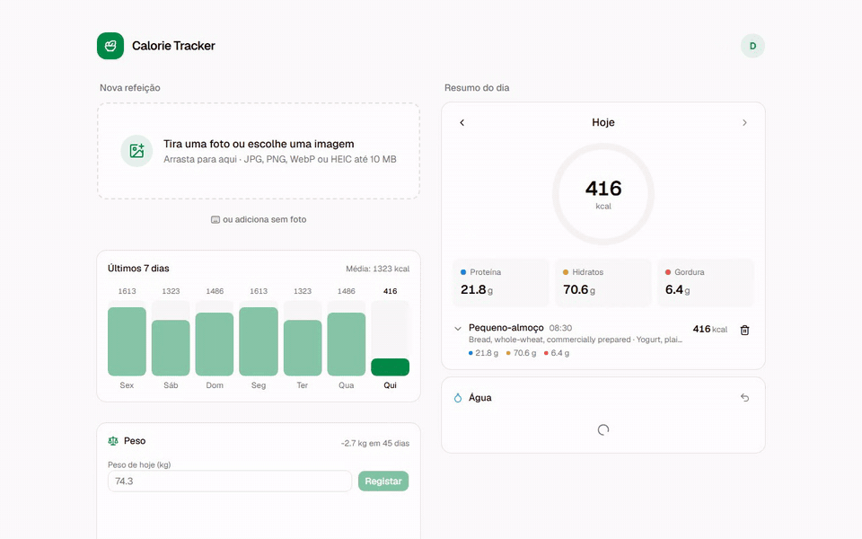
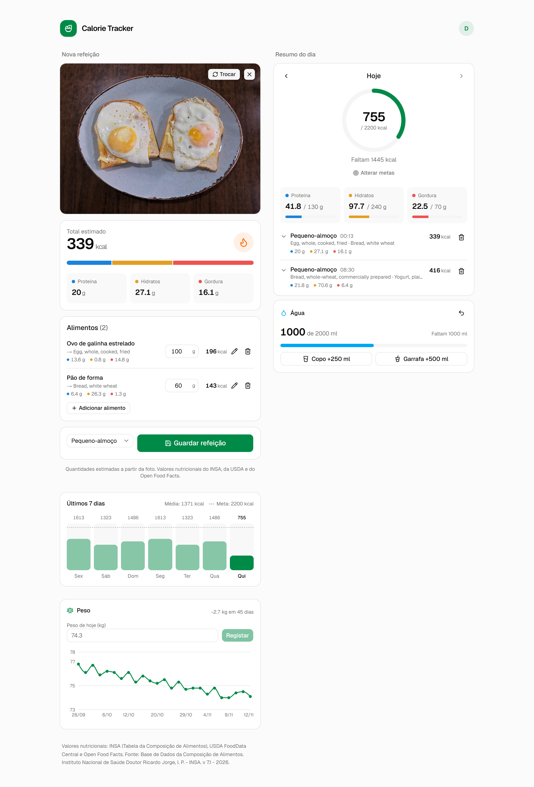
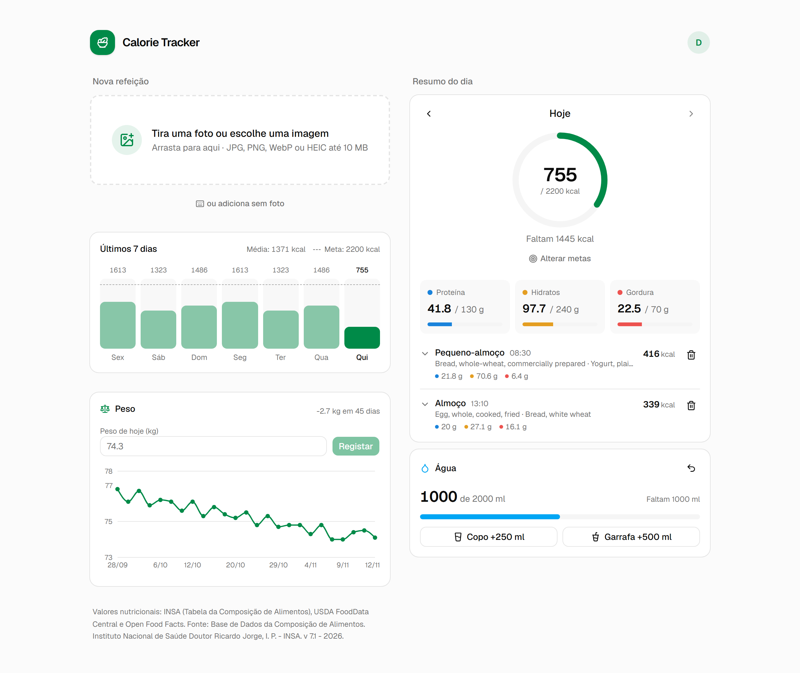
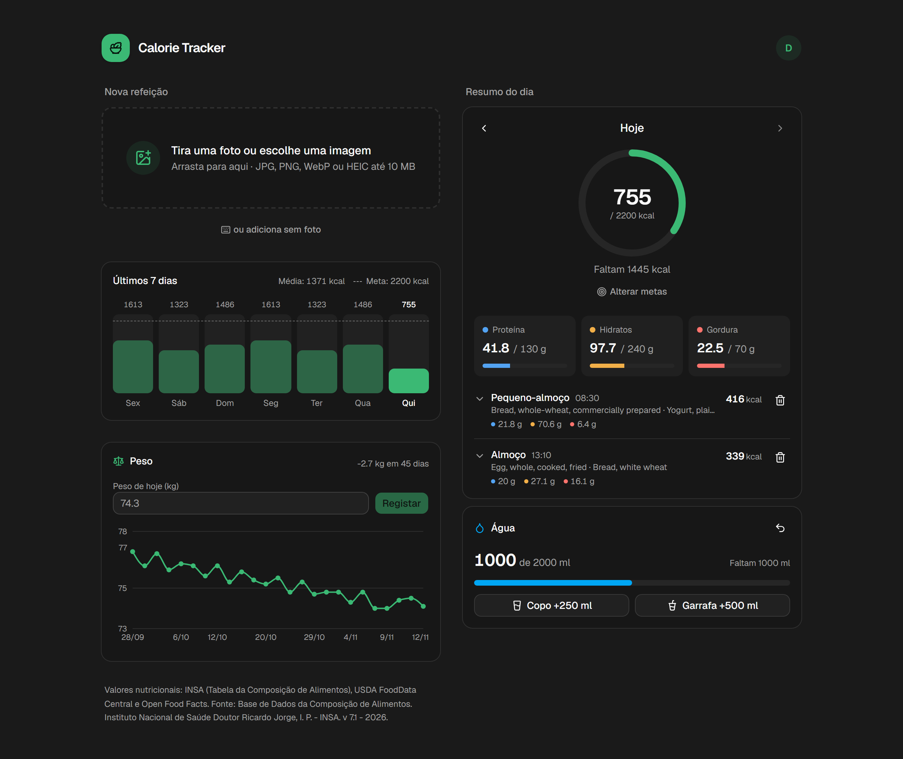
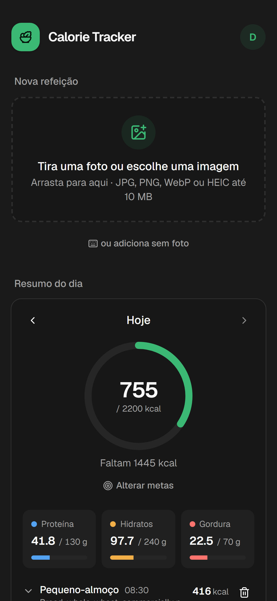

# Calorie Tracker

Tira uma foto à refeição e vê as calorias e macros. O Gemini identifica os alimentos e estima as gramas; os valores nutricionais vêm da Tabela da Composição de Alimentos do INSA, da USDA FoodData Central e do Open Food Facts (códigos de barras).

Web (Next.js) e app mobile (Expo) sobre a mesma API (NestJS + Postgres).



<sub>Vídeo em melhor qualidade: [docs/media/demo.mp4](docs/media/demo.mp4). As imagens usam uma conta de demonstração com dados fictícios.</sub>

| Análise da foto | Resumo do dia |
| --- | --- |
|  |  |

| Tema escuro | Telemóvel |
| --- | --- |
|  |  |

## Estrutura

| Pasta | O quê |
| --- | --- |
| `apps/api` | API NestJS 12 (TypeORM + Postgres, Gemini, USDA, OFF) |
| `apps/web` | Next.js 16 + Tailwind + shadcn/ui |
| `apps/mobile` | App Expo SDK 58 (Expo Router), Android e iOS |
| `packages/db` | Entidades TypeORM partilhadas |
| `packages/shared` | Schemas zod, tipos da API e cálculo de macros (usados pela API e pela web) |

## Arrancar

```sh
pnpm install
cp .env.example .env                       # preenche GEMINI_API_KEY (e USDA_API_KEY)
cp apps/web/.env.example apps/web/.env.local
pnpm db:up                                 # Postgres em localhost:5434
pnpm dev                                   # API em :3001, web em :3000
```

As migrations correm sozinhas quando a API arranca. Abre http://localhost:3000 e cria uma conta.

> **Dados de antes do login:** a primeira conta criada fica com as refeições, metas e correções que já existiam na base de dados.

### App mobile

```sh
cp apps/mobile/.env.example apps/mobile/.env   # EXPO_PUBLIC_API_URL = IP do PC na rede, ex.: http://192.168.0.33:3001
cd apps/mobile && npx expo start               # abre no Expo Go ou num development build
```

A app usa a mesma conta que a web. O token de sessão fica no SecureStore (Keychain/Keystore) e vai no header `Authorization: Bearer`. Fora do modo de desenvolvimento, a app exige que a API use HTTPS, e o build de produção bloqueia tráfego HTTP no Android. O perfil `preview` do `eas.json` abre uma exceção para testares na rede local.

## Tabela portuguesa de alimentos (INSA)

A pesquisa e a análise de fotos procuram primeiro na **Tabela da Composição de Alimentos do INSA** (broa, bacalhau, francesinha, pastel de nata…) e só depois na USDA. Os dados não vêm no repositório (direitos de autor do INSA); importa-os assim:

1. Descarrega o Excel em <https://portfir.insa.min-saude.pt/> (ex.: `insa_tca.xlsx`).
2. `pnpm --filter api import:insa "C:\Users\<tu>\Downloads\insa_tca.xlsx"` (o caminho real do ficheiro que descarregaste)

Pode correr outra vez quando sair uma versão nova: atualiza os alimentos existentes. As condições de utilização obrigam a mostrar a fonte de forma visível. A web e a app já mostram a citação (`INSA_ATTRIBUTION` em `packages/shared`); se mudares de versão da tabela, atualiza o texto lá.

## Funcionalidades

- **Foto → macros:** o Gemini identifica os alimentos (nomes em português), as gramas e a confiança. Pratos compostos (francesinha, lasanha…) contam como um só item, sem repetir os ingredientes. Cada item mostra o nome identificado e, por baixo, o alimento da base de dados usado para os macros; os de confiança baixa aparecem marcados para confirmar. Corrigir um alimento ensina a app para a próxima vez. As fotos são reduzidas para 1024 px antes do envio.
- **Pesquisa:** palavras por qualquer ordem, sem acentos e com tolerância a erros de escrita (`pg_trgm` + `unaccent` no Postgres).
- **Refeições guardadas:** trocar um alimento ou corrigir as gramas; os macros são recalculados no servidor.
- **Água:** copos e garrafas, meta diária e progresso do dia.
- **Peso:** um registo por dia e gráfico dos últimos 90 dias.

## Testes

```sh
pnpm test          # unitários
pnpm test:e2e      # API completa contra a BD calorie_tracker_test
```

Os e2e nunca usam a BD de desenvolvimento: usam `TEST_DATABASE_URL` ou a `DATABASE_URL` com `_test` no nome, e recusam correr noutra. Cria-a uma vez com:

```sh
docker compose exec postgres createdb -U calorie calorie_tracker_test
```

## Migrations

```sh
pnpm --filter api migration:generate src/migrations/NomeDaMigration
```

Depois acrescenta a classe gerada à lista `migrations` em `apps/api/src/data-source.ts`.

## Segurança

- **Login** com email e password. As passwords são guardadas com scrypt (parâmetros OWASP); a sessão é um token aleatório num cookie `httpOnly` + `SameSite=Lax` (`__Host-` + `Secure` em produção), e na BD só fica o SHA-256 do token. O logout invalida a sessão no servidor.
- **Recuperação de password** por email (Resend). O link leva o token no fragmento (`#token=`), expira em 30 minutos, só funciona uma vez e só o mais recente é válido. A resposta a "esqueci-me" é sempre igual, exista a conta ou não, e ao mudar a password todas as sessões abertas terminam. Sem `RESEND_API_KEY`, em desenvolvimento o link aparece no terminal da API.
- **Todas as rotas exigem sessão** (guard global), exceto `/auth/login`, `/auth/register` e `/health`. Refeições, metas e correções de alimentos são de cada utilizador. Pedir dados de outra pessoa dá 404.
- **Os valores nutricionais vêm sempre do servidor:** a API ignora os macros que o cliente envie e usa os da USDA/OFF guardados na BD (antes, um cliente podia gravar valores falsos no catálogo partilhado).
- **Rate limiting:** 120 pedidos/min por IP; 5/min em login e registo; 10/min na análise de fotos (cada uma gasta quota do Gemini).
- **CSRF:** pedidos que alteram dados só são aceites vindos de `WEB_ORIGIN` (Fetch Metadata). CORS com credenciais só para essa origem.
- **Headers:** headers de segurança tipo helmet na API; CSP, `X-Frame-Options`, `nosniff` e HSTS (em produção) na web.

### Antes de pôr online

1. `NODE_ENV=production` (liga cookies `Secure`) e HTTPS na web e na API.
2. A web e a API têm de ser do **mesmo site** (ex.: `app.exemplo.pt` e `api.exemplo.pt`), senão o browser não envia o cookie `SameSite=Lax`.
3. Depois de criares a tua conta, mete `ALLOW_REGISTRATION=false` se não quiseres que outras pessoas se registem (e gastem a tua quota do Gemini).
4. Atrás de um proxy (nginx, Caddy, etc.), define `TRUST_PROXY=1` para o rate limit ver o IP real.
5. Muda `POSTGRES_PASSWORD` e não exponhas a porta do Postgres.
6. Define `RESEND_API_KEY` e um `MAIL_FROM` com um domínio verificado no Resend, senão a recuperação de password não envia emails.
